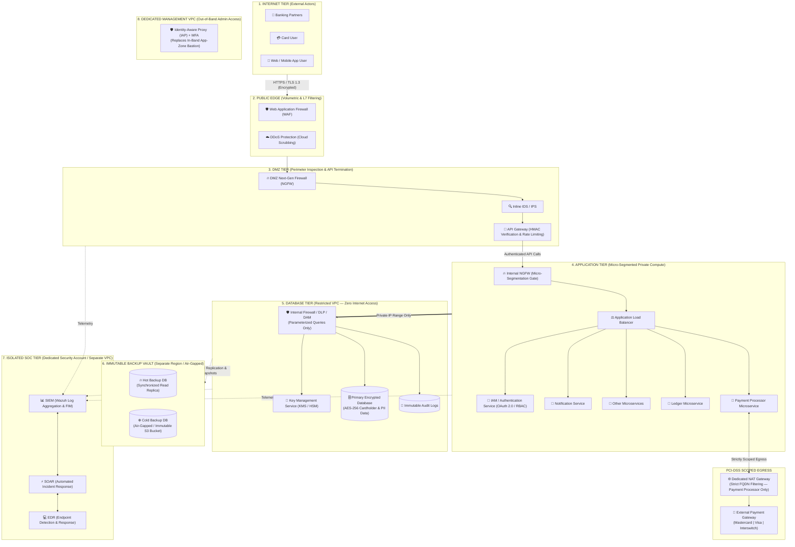

# PayLink Africa Secure System Architecture: SABSA-Driven Defense-in-Depth & PCI-DSS Fintech Network Redesign


> **Executive Summary:** This project presents the end-to-end design and architectural hardening of **PayLink Africa**, an online payment processing and digital wallet fintech platform connecting banking partners, card users, web/mobile clients, and external payment networks (Mastercard, Visa, and Interswitch). Driven by the **SABSA (Sherwood Applied Business Security Architecture)** framework and **PCI-DSS** compliance mandates, this case study documents both the baseline multi-tier security architecture and its evolution into a hardened, production-grade cloud topology. Key architectural improvements enforce deterministic inline inspection (`WAF/DDoS -> DMZ NGFW -> IPS -> API Gateway -> Internal NGFW -> ALB`), isolate the Security Operations Center (`SIEM/SOAR/EDR`) into a dedicated Security Account, lock the Database Tier inside a zero-internet private VPC protected by Database Activity Monitoring (`Firewall/DLP/DAM`) and air-gapped/immutable S3 backups, move administrative access out of the application data plane into a dedicated Management VPC with Identity-Aware Proxy (`IAP`), and restrict external payment egress strictly to the `Payment Processor` via a dedicated NAT Gateway with FQDN filtering.

| Field | Detail |
| :--- | :--- |
| **Project Title** | Designing a Secure System Architecture — PayLink Africa |
| **Platform Type** | Fintech Online Payment Gateway & Digital Wallet Platform |
| **Security Architect** | Chinaza Nnamani (`SOE/025/5707`) |
| **Architectural Frameworks** | SABSA (Sherwood Applied Business Security Architecture), PCI-DSS, NIST CSF, Zero Trust |
| **Core Security Principles** | CIA Triad Enforcement, Defense-in-Depth, Principle of Least Privilege (PoLP), Micro-Segmentation |
| **External Integrations** | Mastercard, Visa, and Regional Payment Switches (Interswitch) |

---

## Table of Contents
- [Tools Used](#tools-used)
- [Skills Learned](#skills-learned)
- [1. Problem Statement & Objectives](#1-problem-statement--objectives)
- [2. Architecture & Design Overview](#2-architecture--design-overview)
- [3. Technology Stack & Tooling](#3-technology-stack--tooling)
- [4. Full Documentation Index](#4-full-documentation-index)
- [5. Implementation Walkthrough](#5-implementation-walkthrough)
  - [Phase 1: Baseline Multi-Tier Architecture & Security Controls Mapping](#phase-1-baseline-multi-tier-architecture--security-controls-mapping)
  - [Phase 2: Architectural Hardening & Structural Improvements](#phase-2-architectural-hardening--structural-improvements)
  - [Phase 3: Enforcing the CIA Triad & Threat Mitigation Strategies](#phase-3-enforcing-the-cia-triad--threat-migration-strategies)
- [6. Validation, Testing & Proof of Work](#6-validation-testing--proof-of-work)
- [7. Key Challenges & Trade-Offs](#7-key-challenges--trade-offs)
- [8. Future Enhancements](#8-future-enhancements)
- [Author & Contact](#author--contact)

---

## Tools Used

**Architecture, Frameworks & Compliance**  
-F08705?style=for-the-badge&logo=diagramsdotnet&logoColor=white)


**Edge, Network & Perimeter Security**  
-FF9900?style=for-the-badge&logo=amazonwebservices&logoColor=white)
-D9232E?style=for-the-badge&logo=paloaltonetworks&logoColor=white)
-FF4F8B?style=for-the-badge&logo=amazonapigateway&logoColor=white)
-844FBA?style=for-the-badge)

**Application, Data & SecOps Stack**  


---

## Skills Learned

**Architecture & Engineering**  


**Security Operations & Threat Mitigation**  
_%26_DLP-Data_Protection-critical?style=flat-square)

-SecOps_Resilience-success?style=flat-square)

---

## 1. Problem Statement & Objectives

### Background & Risk / Bottleneck
**PayLink Africa** is a high-volume fintech online payment and digital wallet platform that processes sensitive cardholder data, personal identifiable information (PII), and real-time ledger transactions between **Banking Partners**, **Card Users**, **Web/Mobile App Users**, and **External Payment Gateways** (Mastercard, Visa, and Interswitch).

While the **Initial Infrastructure Design** established a multi-tier layout (Public Edge, DMZ, Application Tier, Database Tier, and SOC), a rigorous architectural review identified **five critical structural bottlenecks** that exposed the platform to lateral movement, firewall bypass, ransomware backup destruction, and SOC blinding:
1. **API Traffic Firewall Bypass:** In the initial design, authenticated API traffic from the `API Gateway` bypassed the `DMZ NGFW` / `Internal NGFW` inspection chain, creating an uninspected path into the application tier.
2. **In-Band Administrative Access (Bastion in App Zone):** Placing the `VPN Gateway` in the DMZ and the `Bastion Host (Jump Server)` directly inside the `Application Tier` mixed privileged administrative traffic with customer payment processing workloads, increasing the blast radius of a compromised employee account.
3. **Shared SOC Network Boundary:** The `SOC Tier` (`SIEM`, `SOAR`, `EDR`) shared the same overarching network boundary/VPC as the `DMZ`, `Application`, and `Database` tiers—meaning a full network compromise could blind or disable the organization's security monitoring ("the eyes" of the organization).
4. **Co-Located Database Backups:** `Hot Backup DB` and `Cold Backup DB` resided within the same `Database Tier` boundary as the primary database, leaving backups vulnerable to simultaneous destruction during a ransomware attack or availability zone failure.
5. **Over-Permissive General Egress Proxy:** Outbound traffic to the `External Payment Gateway` relied on a general egress proxy path accessible from the broader application/firewall layer rather than restricting outbound card-network communication strictly to the `Payment Processor` microservice.

### Core Objectives
* **Objective 1 (SABSA Business-Driven Alignment):** Translate PayLink Africa's core business drivers—**customer trust**, **regulatory compliance (PCI-DSS)**, and **high availability**—into a layered logical and physical security architecture where every control delivers measurable business value.
* **Objective 2 (Deterministic Inline Traffic Inspection):** Re-architect north-south traffic flow so every external request traverses `Public Edge (WAF/DDoS) -> DMZ NGFW -> IDS/IPS -> API Gateway -> Internal NGFW -> Application Load Balancer -> Microservices -> Internal Firewall/DLP/DAM -> Encrypted Database` without bypassing any inspection checkpoint.
* **Objective 3 (Out-of-Band Admin, SOC & Backup Isolation):** Decouple privileged administration into a dedicated Management VPC / Identity-Aware Proxy (`IAP`), isolate the `SOC (SIEM/SOAR/EDR)` into an independent `Security Account`/VPC boundary, and move database backups into an **Air-Gapped / Immutable S3 Bucket** in a separate region/vault.
* **Objective 4 (Strict PCI-DSS Egress & Zero-Internet Database VPC):** Place the `Database Tier` in a completely restricted VPC with zero internet access (reachable only via the Application Tier's private IP range) and scope `External Payment Gateway` egress exclusively to the `Payment Processor` through a **Dedicated NAT Gateway with strict FQDN filtering**.

> [!IMPORTANT]
> **Scope Note:** This `README.md` is a complete, self-contained security architecture case study. It consolidates the SABSA framework justification, the initial vs. improved architecture blueprints, security control mappings, threat mitigation strategies, and architectural trade-offs without requiring separate `architecture.md`, `setup.md`, or `troubleshooting.md` files.

---

## 2. Architecture & Design Overview

### Improved Production Architecture Diagram

*Figure 1: Improved PayLink Africa Security Architecture illustrating deterministic inline NGFW/IPS chaining, isolated SOC VPC boundary, zero-internet Database VPC with DAM, Air-Gapped/Immutable S3 backups, and Dedicated NAT Gateway FQDN egress filtering.*

### System Workflow (Mermaid Diagram — Improved State)



### Key Design Decisions (Initial vs. Improved Architecture)
1. **Strict Inline Inspection Chain (`Public Edge -> DMZ NGFW -> IPS -> API Gateway -> Internal NGFW -> ALB`):** In the initial design, API traffic bypassed the internal firewall layer. In the improved design, every inbound packet is forced through `WAF/DDoS` at the edge, inspected by the `DMZ NGFW`, routed through the inline `IDS/IPS`, terminated at the `API Gateway`, and re-inspected by the `Internal NGFW` before reaching the `Application Load Balancer`.
2. **Dedicated NAT Gateway with Strict FQDN Filtering for Payment Egress:** In a PCI-DSS environment, general application servers must never have arbitrary outbound internet access. The improved architecture replaces the general egress proxy with a **Dedicated NAT Gateway enforcing strict FQDN allowlisting**, ensuring that **only the `Payment Processor` microservice** can initiate outbound connections to external payment networks (Mastercard, Visa, Interswitch).
3. **Out-of-Band SOC Isolation (`Dedicated Security Account / Separate VPC`):** Moving the `SIEM`, `SOAR`, and `EDR` management plane out of the shared application network boundary into a separate `Security Account`/VPC ensures that even if an attacker compromises the primary application VPC, they cannot blind, tamper with, or disable the security operations center.
4. **Zero-Internet Database VPC with `DAM` & Air-Gapped/Immutable Backups:** The `Database Tier` is isolated in a restricted VPC with **no internet access—not even via a proxy**—and is reachable exclusively from the Application Tier's private IP range through an internal `Firewall / DLP / DAM` (Database Activity Monitoring) appliance. Furthermore, `Hot Backup DB` and `Cold Backup DB` are separated into an **Air-Gapped / Immutable S3 Bucket** in a separate vault/region so ransomware cannot encrypt or delete backups.
5. **Removal of In-Band Bastion in Favor of Dedicated Management VPC / IAP:** The in-band `Bastion Host (Jump Server)` inside the Application Zone was removed and replaced with a dedicated **Management VPC / Identity-Aware Proxy (IAP)** workflow, eliminating exposed SSH/RDP jump boxes from the payment processing environment.

---

## 3. Technology Stack & Tooling

| Architectural Tier | Component / Service | Role in PayLink Africa | Security & Compliance Justification |
| :--- | :--- | :--- | :--- |
| **Internet Tier** | Banking Partners, Card Users, Web/App Users | External clients and institutional partners initiating payment and wallet requests | Untrusted external zone; all connections must negotiate `HTTPS / TLS 1.3` |
| **Public Edge** | `WAF` & `DDoS Protection` | Absorbs volumetric DDoS floods and blocks OWASP Top 10 payloads (SQLi, XSS) at the edge | Preserves platform **Availability** and drops malformed HTTP payloads before the DMZ |
| **DMZ Tier** | `DMZ NGFW`, `IDS/IPS`, `API Gateway` | Performs deep packet inspection, signature/anomaly detection, HMAC payload validation, and L7 rate-limiting | Ensures zero direct internet-to-application connectivity; validates API integrity |
| **Application Tier** | `Internal NGFW`, `Load Balancer`, `IAM (OAuth 2.0)`, Microservices (`Payment Processor`, `Ledger`, `Notification`, `Other`) | Processes authenticated payment workflows, double-entry ledger updates, and user notifications | Enforces **Least Privilege** and micro-segmentation between internal services |
| **Egress Layer** | `Dedicated NAT Gateway` (FQDN Filtered) -> `External Payment Gateway` | Connects strictly from `Payment Processor` to Mastercard, Visa, and Interswitch | Satisfies **PCI-DSS** outbound scoping; prevents data exfiltration from non-payment microservices |
| **Database Tier** | `Firewall / DLP / DAM`, `Key Management Service (KMS)`, `Encrypted Database (AES-256)`, `Audit Logs` | Stores cardholder data, PII, wallet balances, and cryptographic keys in a zero-internet VPC | Enforces **Confidentiality** via `AES-256` encryption at rest, parameterized queries, and DLP/DAM inspection |
| **Backup Vault** | `Hot Backup DB` (Read Replica) & `Cold Backup DB` (Air-Gapped / Immutable S3) | Provides rapid failover (`Hot`) and ransomware-proof disaster recovery (`Cold`) | Prevents ransomware from deleting or encrypting backup snapshots |
| **SOC Tier** | `SIEM` (Wazuh), `SOAR`, `EDR` | Isolated in a dedicated Security Account/VPC; aggregates logs, monitors File Integrity (FIM), and automates response | Protects the "eyes" of the organization and detects insider or external threats in real time |
| **Admin Plane** | Dedicated Management VPC / Identity-Aware Proxy (`IAP`) | Out-of-band zero-trust administrative access with MFA | Replaces the legacy in-band Application Zone Bastion Host |

---

## 4. Full Documentation Index

All architectural specifications, framework justifications, and before-and-after improvement analyses are consolidated directly within this `README.md`:

```text
paylink-africa-security-architecture/
├── DESIGNING_A_SECURE_SYSTEM_ARCHITECTURE_CHINAZA_NNAMANI_SOE_025_5707.pdf  # Initial Architecture & SABSA Report
├── Improved_PAYLINK_NET.drawio.jpg                                          # Hardened Production Architecture Diagram
├── Summary_Table_of_Improvements.pdf                                        # Architectural Improvements Matrix
└── README.md                                                                # Complete Self-Contained Case Study
```

| Section | Description |
| :--- | :--- |
| [**1. Problem Statement & Objectives**](#1-problem-statement--objectives) | Analysis of the 5 architectural bottlenecks in the initial design and core business/security objectives. |
| [**2. Architecture & Design Overview**](#2-architecture--design-overview) | Visual architecture diagram (`Improved_PAYLINK_NET.drawio.jpg`), Mermaid workflow, and key design decisions. |
| [**3. Technology Stack & Tooling**](#3-technology-stack--tooling) | Tier-by-tier breakdown of every security appliance, microservice, and datastore. |
| [**5. Implementation Walkthrough**](#5-implementation-walkthrough) | Deep dive into SABSA alignment, security controls mapping, structural improvements, CIA triad, and threat mitigation. |
| [**6. Validation, Testing & Proof of Work**](#6-validation-testing--proof-of-work) | Summary Table of Improvements (Current vs. Improved State) and Threat Mitigation Validation Matrix. |
| [**7. Key Challenges & Trade-Offs**](#7-key-challenges--trade-offs) | Engineering reflections on latency vs. inspection depth, cloud-native AWS translation, and cost/usability balance. |

---

## 5. Implementation Walkthrough

### Phase 1: Baseline Multi-Tier Architecture & Security Controls Mapping
The architectural design for **PayLink Africa** is fundamentally driven by the **SABSA (Sherwood Applied Business Security Architecture)** framework. Unlike purely technical frameworks, SABSA ensures that every security service is directly derived from business requirements. For a fintech platform, the primary business drivers are **customer trust**, **regulatory compliance (PCI-DSS)**, and **high availability** for uninterrupted payment processing. Following SABSA's top-down methodology, the baseline design mapped five core security control domains across the platform:

* **Access Control & Authentication:** Centralized `IAM / Authentication Service` in the Application Tier manages merchant and customer authentication using `OAuth 2.0` and Role-Based Access Control (`RBAC`). Privileged administrative access requires multi-factor authentication (`MFA`) and out-of-band identity verification.
* **Encryption (In-Transit & At-Rest):** All data in transit from external clients (`Banking Partners`, `Card Users`, `Web/App Users`) through the DMZ and Application Tier to the Database Tier is encrypted using `HTTPS / TLS 1.3`. Sensitive data at rest (card numbers, PII, ledger records) in the Database Tier and all backup vaults is encrypted using `AES-256` managed via a dedicated `Key Management Service (KMS)`.
* **Backup & Disaster Recovery:** A synchronized read replica (`Hot Backup DB`) provides immediate high-availability failover, while encrypted snapshots (`Cold Backup DB`) are routinely shipped to an off-site, air-gapped / immutable S3 disaster recovery vault to guarantee business continuity.
* **Monitoring & Logging:** `SIEM`, `SOAR`, and `EDR` (powered by **Wazuh**) collect telemetry across the DMZ, Application, and Database tiers for **File Integrity Monitoring (FIM)**, real-time behavioral threat detection, unified audit log aggregation, and automated incident response.
* **Risk Management & Defense-in-Depth:** Strict VPC/network segmentation isolates cardholder datastores, while parameterized database queries, secrets management via `KMS`, routine vulnerability scanning, and penetration testing mitigate operational and exploitation risks.

<details>
<summary><strong>Click to expand: Baseline Initial Architecture Diagram (Reference)</strong></summary>

```text
[INITIAL ARCHITECTURE FLOW — PRE-HARDENING]
Internet (Banking Partners | Card User | Web/App User | Admins/Employees)
   │
   ▼
Public Edge (WAF | DDoS Protection) ──[HTTPS/TLS 1.3]──► DMZ (NGFW | API Gateway | IDS/IPS | VPN Gateway)
   │                                                        │
   │  (Bottleneck 1: API Traffic bypassed DMZ/Internal NGFW) │ (Bottleneck 2: Admin VPN -> Bastion inside App Zone)
   ▼                                                        ▼
Application Tier (Internal NGFW | Load Balancer | IAM | Bastion Host | Notification | Payment Processor | Ledger | Other)
   │                                                        │
   │  (Bottleneck 5: General Egress Proxy to External PG)    │ (Bottleneck 3: SOC shared main network boundary)
   ▼                                                        ▼
Database Tier (Firewall/DLP | KMS | Encrypted DB | Audit Logs | Hot & Cold Backups inside same DB zone [Bottleneck 4])
```

</details>

---

### Phase 2: Architectural Hardening & Structural Improvements
To elevate the initial blueprint to a hardened, PCI-DSS compliant production posture, five major architectural upgrades were engineered (as captured in `Improved_PAYLINK_NET.drawio.jpg` and the `Summary Table of Improvements`):

1. **Enforced Linear Chaining for API Traffic (`No Firewall Bypass`):**
   * *Initial Flaw:* API traffic bypassed the internal NGFW inspection layer.
   * *Engineered Fix:* Enforced a strict, non-bypassable inspection chain:
     $$\text{Public Edge (WAF/DDoS)} \rightarrow \text{DMZ NGFW} \rightarrow \text{IDS/IPS} \rightarrow \text{API Gateway} \rightarrow \text{Internal NGFW} \rightarrow \text{Application Load Balancer} \rightarrow \text{Application Tier} \rightarrow \text{Internal Firewall/DLP/DAM} \rightarrow \text{Database}$$
2. **Out-of-Band Administrative Access (`Dedicated Management VPC / IAP`):**
   * *Initial Flaw:* `Bastion Host (Jump Server)` was deployed directly inside the `Application Tier` and connected via a DMZ VPN Gateway.
   * *Engineered Fix:* Removed the in-band Bastion Host and Admin VPN from the application data plane, relocating administrative access to a **Dedicated Management VPC / Identity-Aware Proxy (IAP)** with hardware-enforced MFA and zero standing privileges.
3. **Isolated SOC Boundary (`Dedicated Security Account / Separate VPC`):**
   * *Initial Flaw:* The `SOC Tier` (`SIEM`, `SOAR`, `EDR`) shared the main network boundary with the Application and Database tiers.
   * *Engineered Fix:* Isolated all SOC components (`SIEM`, `SOAR`, `EDR`) into a **separate Security Account / VPC boundary**. This mitigates the risk of an attacker compromising the "eyes" of the organization if the main application network is breached.
4. **Zero-Internet Database VPC & Air-Gapped / Immutable Backups:**
   * *Initial Flaw:* `Hot Backup DB` and `Cold Backup DB` were stored inside the same `Database Tier` boundary.
   * *Engineered Fix:* Placed the `Database Tier` in a **completely separate, restricted VPC with zero internet access**—not even via a proxy—reachable exclusively from the Application Tier's private IP range through an internal `Firewall / DLP / DAM` (Database Activity Monitoring) gateway. Moved backups to a separate vault featuring an **Air-Gapped backup / Immutable S3 Bucket** (Object Lock in Compliance Mode) to prevent ransomware from deleting or encrypting backups.
5. **Scoped PCI-DSS Egress (`Dedicated NAT Gateway with Strict FQDN Filtering`):**
   * *Initial Flaw:* Outbound traffic to the `External Payment Gateway` used a general egress proxy.
   * *Engineered Fix:* Replaced the general proxy with a **Dedicated NAT Gateway enforcing strict FQDN filtering**. In compliance with PCI-DSS, **only the `Payment Processor` microservice** is permitted to communicate with external payment gateways (Mastercard, Visa, Interswitch), and all other microservices (`Notification`, `Ledger`, `Other`) are blocked from initiating external payment egress.

<details>
<summary><strong>Click to expand: Hardened Network & Egress Policy Specification (YAML)</strong></summary>

```yaml
# PayLink Africa — Hardened Micro-Segmentation & Egress Control Policy
architecture_version: "2.0-Hardened-PCI-DSS"

traffic_chaining:
  north_south_ingress:
    - step_1: "Public_Edge (WAF + DDoS_Protection) [TLS_1.3_Strict]"
    - step_2: "DMZ_NGFW -> Inline_IDS_IPS -> API_Gateway [HMAC_SHA256 + Rate_Limit]"
    - step_3: "Internal_NGFW -> Application_Load_Balancer -> App_Microservices"
    - step_4: "Database_Firewall_DLP_DAM [Parameterized_Queries_Only] -> Encrypted_DB_AES256"

egress_control:
  external_payment_gateway:
    allowed_source_service: "Payment_Processor_Microservice_Only"
    denied_source_services: ["Ledger", "Notification_Service", "Other_Microservices", "IAM"]
    gateway_type: "Dedicated_NAT_Gateway"
    fqdn_allowlist:
      - "api.mastercard.com"
      - "api.visa.com"
      - "webpay.interswitchng.com"
    default_egress_action: "DROP_AND_ALERT_SIEM"

database_vpc_policy:
  internet_gateway_attached: false
  nat_gateway_attached: false
  proxy_access_allowed: false
  allowed_ingress_cidr: "10.20.0.0/16 (Application_Tier_Private_IP_Range_Only)"
  inspection_layer: "Firewall_DLP_DAM"

backup_vault_policy:
  isolation: "Separate_AWS_Account_And_Region_Vault"
  cold_backup_storage: "Immutable_S3_Object_Lock_Compliance_Mode_And_Air_Gapped_Vault"
  encryption: "AES_256_KMS_Customer_Managed_Key"
```

</details>

---

### Phase 3: Enforcing the CIA Triad & Threat Mitigation Strategies

#### Enforcing the CIA Triad
* **Confidentiality:** Enforced rigorously to protect cardholder data (PAN) and PII. All traffic in transit is encrypted with `TLS 1.3`, preventing packet sniffing across public or internal links. Data at rest in the zero-internet `Database Tier` and immutable backup vault is encrypted with `AES-256` via `KMS`, and access is governed by strict `RBAC` and `OAuth 2.0`.
* **Integrity:** Guarantees that financial transactions and wallet balances remain accurate and tamper-proof. API requests between banking partners/merchants and the `API Gateway` are signed using **cryptographic hashing (`HMAC`)** so payloads cannot be altered in transit. Additionally, **File Integrity Monitoring (`FIM`)** via the Wazuh `SIEM`/`EDR` continuously monitors host servers for unauthorized modifications to critical binaries or configurations.
* **Availability:** Ensures uninterrupted payment processing through multi-layer redundancy: cloud-edge `DDoS Protection` absorbs volumetric floods, the internal `Application Load Balancer` distributes requests across redundant microservice instances, and the synchronized `Hot Backup DB` read replica enables rapid automated failover.

#### High-Impact Fintech Threat Mitigation Strategies
1. **Injection Attacks (SQLi / XSS):**
   * *Primary Control (Edge):* The `Public Edge WAF` inspects inbound HTTP/HTTPS requests and drops malicious SQL injection and Cross-Site Scripting payloads.
   * *Secondary Control (Application & Database):* The Application Tier enforces strict schema/input validation and communicates with the database exclusively via **parameterized queries**, while the inline `Firewall / DLP / DAM` inspects database protocol traffic before it reaches the `Encrypted Database`.
2. **Distributed Denial of Service (DDoS):**
   * *Primary Control (Volumetric):* Cloud-edge `DDoS Protection` scrubs volumetric Layer 3/4 floods before they reach PayLink Africa's DMZ.
   * *Secondary Control (Application Layer 7):* Rate-limiting and throttling at the `API Gateway` prevent Layer 7 resource exhaustion against payment and ledger endpoints.
3. **Insider Threat / Compromised Administrator:**
   * *Primary Control (Access & Segmentation):* Admin access is decoupled into a dedicated Management VPC / `IAP` with MFA, and lateral movement is blocked by the `Internal NGFW` and `Database Firewall/DLP/DAM`.
   * *Secondary Control (Isolated SOC Detection & Response):* The out-of-band `Wazuh SIEM` in the isolated SOC VPC continuously analyzes administrator and database activity (`Audit Logs`), immediately triggering `SOAR` playbooks to revoke credentials and isolate hosts if anomalous behavior (such as bulk data exports or off-hours database queries) is detected.

---

## 6. Validation, Testing & Proof of Work

### Summary Table of Architectural Improvements (Baseline vs. Hardened State)

| Component | Current State (Initial Design) | Improved State (Hardened Design) | Security & Compliance Impact | Status |
| :--- | :--- | :--- | :--- | :--- |
| **API Traffic** | Bypasses internal NGFW | **Must pass through Internal NGFW / Micro-segmentation** (`WAF/DDoS -> DMZ NGFW -> IPS -> API Gateway -> Internal NGFW -> ALB`) | Eliminates uninspected API paths; enforces multi-stage deep packet inspection | **Implemented** |
| **Admin Access** | Bastion Host inside Application Zone | **Move to a dedicated Management VPC / Use IAP** (Identity-Aware Proxy) | Removes SSH/RDP jump-box attack surface from the payment processing tier | **Implemented** |
| **SOC Tier** | Shared network boundary with App & DB | **Isolate SOC tools (`SIEM`, `SOAR`, `EDR`) in a dedicated "Security Account" / separate VPC** | Protects the "eyes" of the organization even if the main application VPC is compromised | **Implemented** |
| **Backups** | Stored in Database zone | **Move to a separate, immutable region/vault** (`Air-Gapped Backup` / `Immutable S3 Bucket`) | Prevents ransomware or rogue admins from deleting or encrypting database backups | **Implemented** |
| **Egress** | General Egress Proxy | **Dedicated NAT Gateway with strict FQDN filtering** (scoped strictly to `Payment Processor` only) | Enforces PCI-DSS outbound scoping; blocks unauthorized external connections from other services | **Implemented** |
| **Database Tier** | Isolated behind Firewall/DLP in shared boundary | **Separate, restricted VPC with zero internet access** (not even via proxy) + **DAM** (Database Activity Monitoring) | Reachable only via Application Tier private IP range; blocks direct exfiltration | **Implemented** |

### Threat Scenario & Control Verification Matrix

| Threat / Attack Scenario | Initial Architecture Exposure | Post-Improvement Architectural Defense | Result |
| :--- | :--- | :--- | :--- |
| **Scenario 1: Compromised API Gateway Pivot** | Attacker exploiting API Gateway could bypass Internal NGFW into microservices | Traffic from `API Gateway` is forced through `Internal NGFW` micro-segmentation rules before reaching `Load Balancer` | **Blocked** |
| **Scenario 2: Ransomware Backup Destruction** | Ransomware reaching the Database Tier could target co-located Hot/Cold backups | Cold backups are stored in an **Air-Gapped / Immutable S3 Bucket** in a separate vault/region | **Mitigated** |
| **Scenario 3: Compromised Notification Service Exfiltration** | Non-payment microservice could abuse the general egress proxy to exfiltrate data | Only `Payment Processor` can route through the **Dedicated NAT Gateway**, which enforces strict **FQDN filtering** | **Blocked** |
| **Scenario 4: Attacker Blinding Security Telemetry** | SOC shared the main network boundary, risking lateral movement into SIEM/SOAR | `SOC (SIEM/SOAR/EDR)` is isolated in a separate **Security Account / VPC boundary** receiving unidirectional log streams | **Mitigated** |
| **Scenario 5: SQL Injection & Direct DB Exfiltration** | Relied on WAF, parameterized queries, and basic Firewall/DLP | Added **DAM (Database Activity Monitoring)** alongside `Firewall/DLP` inside a **zero-internet Database VPC** | **Blocked** |

---

## 7. Key Challenges & Trade-Offs

> [!NOTE]
> Applying the SABSA framework to a fintech payment platform surfaces real-world engineering trade-offs between security inspection depth, transaction latency, cloud architecture, and operational cost.

* **Challenge 1: Rigorous Security Inspection vs. Low-Latency Payment Processing**
  * *Issue:* The most difficult architectural challenge was balancing the rigorous multi-layer security required for financial transactions (`WAF/DDoS -> DMZ NGFW -> IPS -> API Gateway -> Internal NGFW -> ALB -> Firewall/DLP/DAM`) with the sub-second latency demanded by an online payment gateway. Applying the SABSA framework highlighted the tension between the business need for speed and the security need for thorough inspection: if security controls are too heavy, transaction timeouts increase and merchants experience payment failures; if controls are too light, the organization faces unacceptable PCI-DSS and financial breach risks.
  * *Resolution:* Offloaded volumetric DDoS scrubbing and TLS 1.3 termination/WAF inspection to high-performance edge nodes, enforced stateless HMAC verification at the `API Gateway`, and used hardware-accelerated `NGFW` and connection-pooled parameterized queries internally to maintain security without introducing transaction timeouts.
* **Challenge 2: Translating Physical/Hybrid Appliances to a Fully Cloud-Native Environment (AWS / Azure / GCP)**
  * *Issue:* Designing an architecture that can transition seamlessly from physical/hybrid appliances to a 100% cloud-native environment (such as AWS).
  * *Resolution:* In a fully cloud-native AWS deployment, the logical SABSA tiers remain identical while the physical layer transforms into cloud-native primitives:
    * Physical firewalls and routers map to **AWS VPCs**, **Security Groups**, **AWS Network Firewall**, and **Network ACLs** for micro-segmentation.
    * Public Edge protection maps to **AWS Shield Advanced** and **AWS WAF**.
    * Standalone database clusters map to **Amazon RDS with Multi-AZ deployments** in isolated private subnets with zero Internet/NAT routes, paired with **AWS KMS** and **S3 Object Lock** in a separate AWSBackup/Vault account.
    * **AWS IAM** becomes the primary security boundary governing serverless execution (**AWS Lambda**) and storage access, while **AWS Organizations** isolates the `SOC` into a dedicated Security Tooling AWS Account.
* **Challenge 3: Balancing Security, Cost, and Usability Through Data Classification**
  * *Issue:* Securing every single microservice and asset to the maximum possible degree is financially irresponsible, inflates operational costs, and introduces friction that degrades usability for legitimate customers.
  * *Resolution:* Applied strict **data classification**—concentrating the most robust, specialized controls (`Firewall/DLP/DAM`, `KMS/HSM`, zero-internet VPC isolation, air-gapped immutable backups, and dedicated FQDN-filtered NAT egress) exclusively around crown-jewel assets (**cardholder data, payment processing, and ledger databases**), while utilizing scalable, automated controls for lower-sensitivity components.

---

## 8. Future Enhancements

- [ ] **Mutual TLS (mTLS) Service Mesh (Istio / AWS App Mesh):** Enforce cryptographic mTLS authentication and authorization between all internal microservices (`Payment Processor`, `Ledger`, `Notification Service`, `IAM`) inside the Application Tier to achieve zero-trust east-west service-to-service communication.
- [ ] **PCI-DSS Card Tokenization Vault:** Introduce a dedicated tokenization engine at the `API Gateway` / `Payment Processor` boundary so raw Primary Account Numbers (PANs) are immediately replaced with non-sensitive tokens before touching internal application logic.
- [ ] **Automated SOAR Containment Playbooks:** Expand `SOAR` integration in the isolated SOC VPC to automatically quarantine compromised endpoints via `EDR`, rotate `KMS` API secrets, and block offending IPs at the `Public Edge WAF` within seconds of a high-severity `SIEM` / `DAM` alert.
- [ ] **Multi-Region Active-Active Disaster Recovery:** Extend the `Application Tier` and `Database Tier` across two geographic cloud regions with automated DNS failover to guarantee near-zero Recovery Time Objective (`RTO`) during regional cloud outages.

---

## Author & Contact

**Chinaza Nnamani**  
Cybersecurity Professional | Cloud & Application Security Architect  
* **GitHub:** [@ch1n4x4](https://github.com/ch1n4x4)
* **LinkedIn:** [linkedin.com/in/chinaza-nnamani](https://linkedin.com/in/chinaza-nnamani)